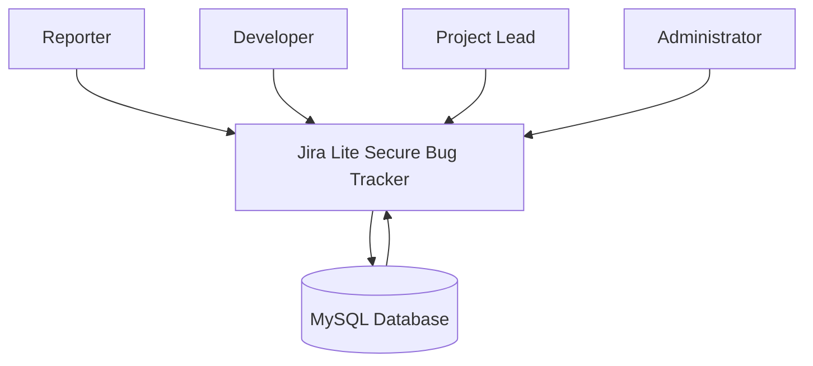
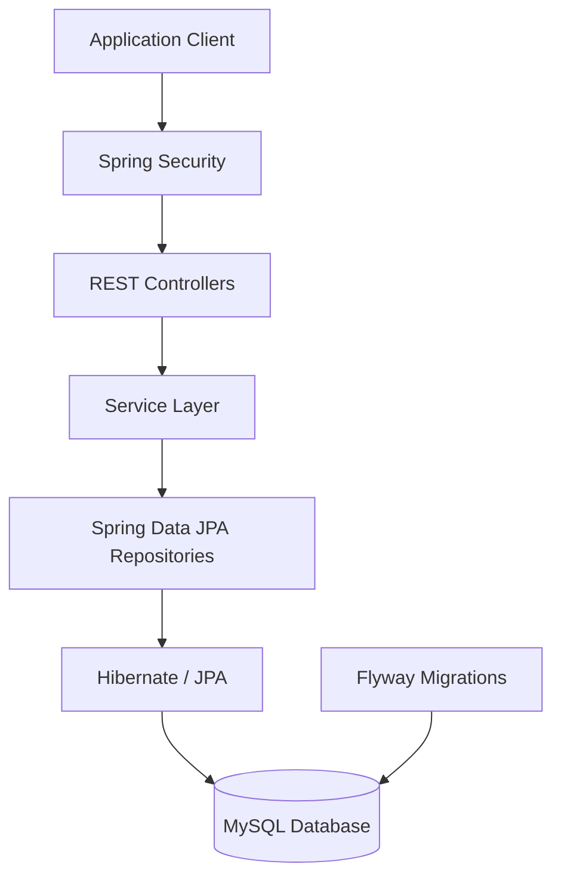
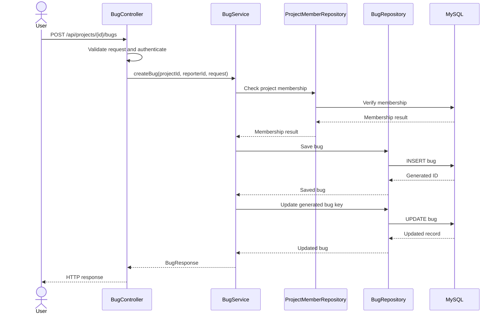

# System Architecture Document
## Jira Lite Secure Bug Tracker

**Document status:** Initial architecture documentation  
**Backend:** Java, Spring Boot  
**Persistence:** Spring Data JPA, Hibernate, MySQL  
**Database migrations:** Flyway  
**Security:** Spring Security, role-based access control

---

## 1. System Context

Jira Lite Secure Bug Tracker is a web-based issue management application designed to help teams report, organize, assign, and track software defects.

The system supports users with different responsibilities, including reporters, developers, project leads, and administrators.

Users interact with the application through its API. The backend validates requests, authenticates users, enforces authorization rules, processes business operations, and persists information in a relational database.

### External actors

| Actor | Responsibility |
|---|---|
| Reporter | Creates and reports bugs within authorized projects. |
| Developer | Participates in project work and handles assigned bugs. |
| Project Lead | Manages project membership and project-level operations. |
| Administrator | Performs privileged administrative operations. |

### System context diagram

---

## 2. Architectural Components

The backend follows a layered application architecture.

### 2.1 Presentation and API Layer

The controller layer exposes REST endpoints for application operations.

Responsibilities:
- Accept HTTP requests.
- Extract authenticated user information.
- Validate request payloads.
- Invoke service-layer operations.
- Return appropriate HTTP responses.

Identified components include:
- `BugController`
- `ProjectController`

### 2.2 Security Layer

Spring Security provides the authentication and authorization foundation.

Responsibilities:
- Authenticate incoming requests.
- Provide the authenticated principal through `AppUserDetails`.
- Support role-based access control.
- Protect application resources from unauthorized access.

Application roles include:
- `REPORTER`
- `DEVELOPER`
- `PROJECT_LEAD`
- `ADMIN`

Project-level authorization additionally checks project membership and membership roles.

### 2.3 Service Layer

The service layer contains business logic and coordinates operations across repositories.

Identified component:
- `BugService`

Responsibilities include:
- Validating project existence.
- Checking project membership.
- Creating bug records.
- Generating bug keys.
- Retrieving project bugs.
- Returning response DTOs.

### 2.4 Repository Layer

Spring Data JPA repositories provide database access.

Identified repositories include:
- `BugRepository`
- `ProjectRepository`
- `ProjectMemberRepository`
- `UserRepository`

Responsibilities:
- Retrieve entities.
- Persist changes.
- Check project membership.
- Find bugs using their unique keys.

### 2.5 Persistence Layer

MySQL stores the application's persistent data.

Hibernate/JPA maps Java entities to relational database tables.

Flyway manages version-controlled database schema changes.

The identified domain entities include:
- User
- Project
- ProjectMember
- Bug
- BugAttachment (subject to verification against the actual source code)

---

## 3. Component Architecture

The client communicates with the backend through HTTP APIs. Spring Security processes protected requests before they reach the controllers. Controllers delegate business operations to services, which use repositories to access persistent data.

Flyway manages database schema evolution independently of normal API request processing.

---

## 4. Data Flow

### 4.1 User Authentication

1. A user submits authentication credentials.
2. Spring Security processes the authentication request.
3. The application verifies the user's credentials using its configured authentication mechanism.
4. An authenticated principal is made available to protected endpoints.
5. Subsequent protected operations use the authenticated identity to enforce authorization.

### 4.2 Bug Creation

1. An authenticated user sends a bug creation request to the bug API.
2. The controller receives the request and validates its payload.
3. The authenticated user's identity is extracted from `AppUserDetails`.
4. `BugService` verifies that the requested project exists.
5. The service checks whether the user belongs to that project.
6. The bug is created and persisted using `BugRepository`.
7. A bug key is generated using the project key and persisted bug ID.
8. The service returns a `BugResponse` to the controller.
9. The API returns the created bug information to the client.

### 4.3 Bug Retrieval

1. The client requests bugs belonging to a project.
2. The request passes through Spring Security.
3. `BugController` obtains the authenticated user.
4. `BugService` verifies project existence and membership.
5. `BugRepository` retrieves bugs belonging to the project.
6. The service maps the entities into response DTOs.
7. The controller returns the results to the client.

### Bug creation data-flow diagram

---

## 5. Trust Boundaries

Trust boundaries separate components with different security responsibilities and levels of trust.

### Boundary 1: External Client to Backend

The client is considered untrusted.

Security requirements:
- Authenticate protected requests.
- Validate incoming request data.
- Reject unauthorized operations.
- Use HTTPS in deployed environments.

### Boundary 2: Security Layer to Application Logic

The security layer establishes the identity of the caller.

Security requirements:
- Use the authenticated principal rather than trusting user IDs supplied by the client.
- Enforce authorization at the appropriate application layer.
- Distinguish global administrator permissions from project-level membership permissions.

### Boundary 3: Application to Database

The application accesses MySQL through the persistence layer.

Security requirements:
- Use parameterized database operations through JPA.
- Restrict database credentials and privileges.
- Avoid exposing database credentials in source control.
- Validate and control schema changes through Flyway migrations.

### Boundary 4: Application Dependencies

The application relies on third-party libraries and framework dependencies.

Security requirements:
- Monitor dependencies for known vulnerabilities.
- Apply security updates.
- Review transitive dependencies.
- Run automated dependency scans.

---

## 6. Key Architectural Decisions

### Decision 1: Layered Backend Architecture

**Decision:** Separate controllers, services, repositories, and persistence responsibilities.

**Rationale:**
- Keeps HTTP handling separate from business logic.
- Makes business rules easier to test.
- Reduces coupling between application layers.
- Supports maintainability as additional features are introduced.

### Decision 2: Relational Database with JPA/Hibernate

**Decision:** Use MySQL with Spring Data JPA and Hibernate.

**Rationale:**
- The application contains structured relationships between users, projects, memberships, and bugs.
- Foreign-key constraints can maintain referential integrity.
- Transactions support consistent multi-step operations.
- Repository abstractions reduce repetitive database-access code.

### Decision 3: Role-Based and Project-Level Authorization

**Decision:** Combine application roles with project membership checks.

**Rationale:**
- Different users require different levels of access.
- Project membership restricts access to project-specific resources.
- Project-level roles allow more granular authorization than a single global role.

### Decision 4: Version-Controlled Database Migrations

**Decision:** Use Flyway for database schema migrations.

**Rationale:**
- Schema changes are version-controlled.
- Database environments can be initialized consistently.
- Applied migrations can be tracked.
- Schema evolution is separated from application business logic.

### Decision 5: Optimistic Locking for Bug Records

**Decision:** Use the JPA `@Version` field in the bug entity.

**Rationale:**
- Helps detect concurrent modifications.
- Prevents silent overwriting of changes made by another transaction.
- Supports safer updates when multiple users work with the same bug.

---

## 7. Scalability and Reliability Considerations

The current architecture provides a foundation for future improvements.

Potential enhancements include:
- Pagination and filtering for large bug collections.
- Database indexing on frequently queried fields.
- Centralized audit logging.
- API rate limiting.
- Automated integration and security testing.
- Centralized monitoring and structured application logs.
- Database backup and recovery procedures.

---

## 8. Known Architecture Limitations

The following details require further verification or implementation:

1. The frontend framework and deployment topology have not yet been verified in this document.
2. The exact authentication mechanism and token/session lifecycle require source-code verification.
3. The complete entity and relationship definitions must be checked against the actual Java entities and Flyway scripts.
4. Production deployment, reverse-proxy, HTTPS, and secret-management configurations require separate review.
5. The current dependency vulnerability scan is pending.

---

## 9. Conclusion

Jira Lite Secure Bug Tracker uses a layered Spring Boot architecture with Spring Security, Spring Data JPA, Hibernate, MySQL, and Flyway.

Its design separates API handling, business logic, authorization, and persistence. The combination of role-based permissions and project membership checks provides a foundation for controlled access to project resources.

The architecture is designed to support maintainable development, relational data integrity, and future expansion of bug tracking functionality.
