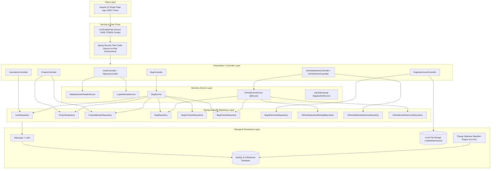
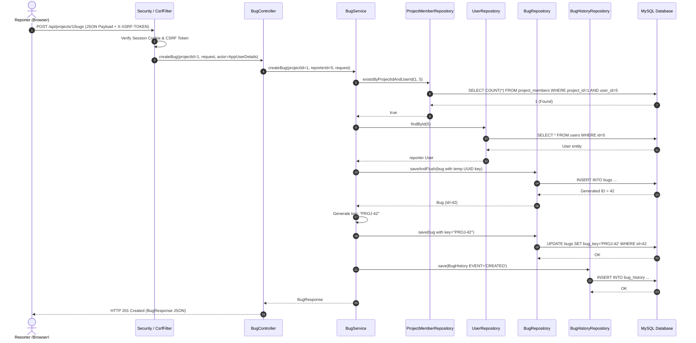
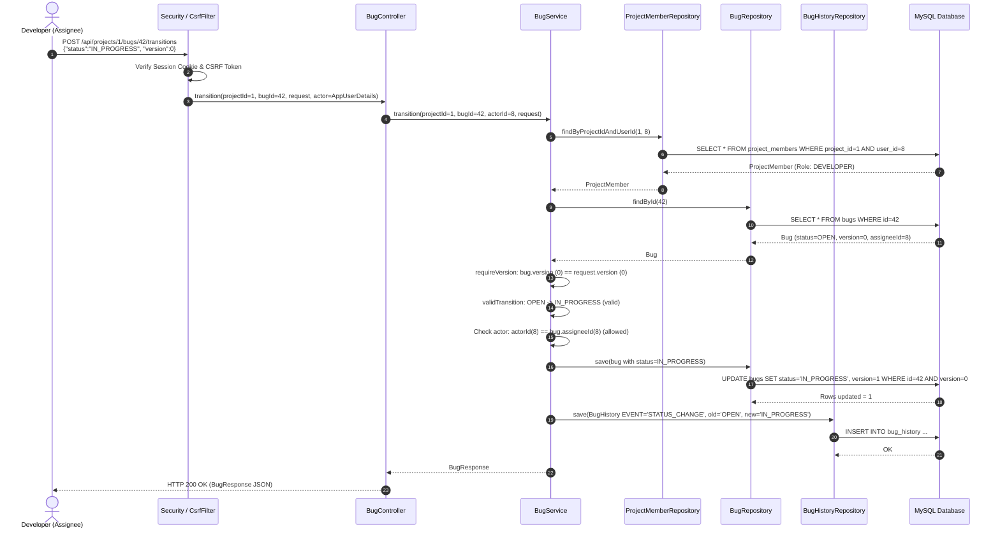

# System Architecture Document

## Jira Lite Secure Bug Tracker

---

## 1. Architectural Overview

Jira Lite Secure Bug Tracker follows a classic multi-tiered architecture built on top of the Spring Boot framework. The application strictly isolates business logic from web concerns and persistence mechanisms. It uses project-scoped authorization to enforce multi-tenant separation across development teams.



---

## 2. Package Map

The backend codebase resides under the root package `com.jiralite.backend`:

| Package | Key Classes | Core Responsibilities |
|---|---|---|
| `com.jiralite.backend` | `BackendApplication` | Application bootstrap, Spring context initialization, and `@EnableAsync`. |
| `com.jiralite.backend.config` | `SecurityConfig`, `CsrfCookieFilter`, `GoogleAuthConfig` | SecurityFilterChain configuration, HTTP security headers, CORS source, CSRF token resolution, Google token verifier bean, password encoder bean, password policy setup. |
| `com.jiralite.backend.security` | `AppUserDetails`, `DatabaseUserDetailsService`, `LoginAttemptService` | Spring Security UserDetails adapter, database principal loader, and brute-force lockout tracking. |
| `com.jiralite.backend.user` | `User`, `GlobalRole`, `UserRepository`, `UserAdminController`, `AdminBootstrap`, `PasswordPolicy` | User entity persistence (with `google_sub`), global administrative role management, admin bootstrap loader, and password constraints. |
| `com.jiralite.backend.auth` | `AuthController`, `SignupController`, `GoogleIdentityService`, `AuthConfigResponse`, `LoginRequest`, `SignupRequest`, `MeResponse` | Session creation, login/logout operations, Google ID token verification and account resolution, user self-registration, and current authenticated identity endpoints. |
| `com.jiralite.backend.project` | `Project`, `ProjectMember`, `ProjectMemberId`, `ProjectRole`, `ProjectController`, `ProjectRepository`, `ProjectMemberRepository` | Project entity, composite primary key membership, project-level roles, member assignment, and project listings. |
| `com.jiralite.backend.bug` | `Bug`, `BugComment`, `BugHistory`, `BugPriority`, `BugSeverity`, `BugStatus`, `BugService`, `BugController`, DTOs | Defect lifecycle tracking, state transitions, optimistic locking validation, comment streams, and immutable audit history. |
| `com.jiralite.backend.attachment` | `BugAttachment`, `BugAttachmentController`, `BugAttachmentRepository` | File upload validation (10 MB limit, path traversal defense), filesystem storage, and content streaming. |
| `com.jiralite.backend.github` | `GitHubWebhookController`, `GitHubAdminController`, `GitHubEventService`, `GitHubRepositoryBinding`, `GitHubWebhookDelivery`, `GitHubEventReference` | HMAC-SHA256 signature verification, repository binding to projects, async commit/PR reference extraction. |

---

## 3. Authentication & Session Flow

The system employs stateful HTTP session authentication using Spring Security's `HttpSessionSecurityContextRepository`.

### Session Architecture
1. **Cookie Configuration:** The session identifier is stored in a cookie named `JSESSIONID` configured with `http-only: true`, `same-site: lax`, a 30-minute idle timeout, and an environment-configurable `secure` flag (`${SESSION_COOKIE_SECURE:false}`).
2. **Session Fixation Defense:** Upon successful credential verification in `AuthController.login()`, the application calls `req.changeSessionId()`. This rotates the session identifier while preserving attributes, neutralizing session fixation attacks.
3. **Context Persistence:** Spring Security 6+ explicit saving is implemented via `contextRepo.saveContext(ctx, req, res)`.
4. **Brute-Force Lockout Defense:**
   - `LoginAttemptService` tracks consecutive failed attempts in the `users.failed_attempts` column.
   - On the 5th consecutive failed attempt, the account's `locked_until` column is set to `Instant.now().plus(15 minutes)`, and `failed_attempts` is reset to 0.
   - A successful login resets `failed_attempts` to 0 and clears `locked_until`.
   - Both invalid credentials and locked/disabled account exceptions return an identical HTTP 401 response (`Invalid email or password`), preventing username enumeration.
5. **Session Invalidation:** `POST /api/auth/logout` invalidates the `HttpSession`, clears the security context, and deletes the `JSESSIONID` cookie, returning `204 No Content`.

### Google Identity Authentication Flow
Google sign-in is out of scope for this release.

---

## 4. CSRF Handling

The application employs the Single-Page Application (SPA) CSRF pattern recommended by Spring Security:

1. **Token Generation:** `SecurityConfig` specifies `.csrf(csrf -> csrf.spa())`.
2. **Cookie Exposure:** `CsrfCookieFilter` runs after `BasicAuthenticationFilter` on every request. It accesses the request attribute `CsrfToken.class.getName()` to ensure the `XSRF-TOKEN` cookie is generated and transmitted to the client.
3. **Client Submissions:** Mutation requests (POST, PUT, PATCH, DELETE) must provide the token in the `X-XSRF-TOKEN` HTTP header.
4. **Login Endpoint Verification:** In `AuthController.login()`, an explicit CSRF check runs before authentication:
   ```java
   MessageDigest.isEqual(
       header.getBytes(StandardCharsets.UTF_8),
       cookie.getBytes(StandardCharsets.UTF_8)
   )
   ```
   If either token is missing or their byte representations do not match, the server rejects the request with HTTP 403 Forbidden.

---

## 5. Role Model & Authorization Matrix

The application enforces a dual-tier authorization model: **Global Application Roles** and **Project Membership Roles**.

### Global Roles (`GlobalRole` enum)

Stored in the `users.role` table column:

1. **`APP_ADMIN`:**
   - Full access to administrative endpoints under `/api/admin/**`.
   - Can create new projects (`POST /api/projects`).
   - Can appoint `PROJECT_LEAD` members to any project (`POST /api/projects/{id}/members`).
   - Can create, list, and patch global user accounts (`/api/admin/users`).
   - Can bind GitHub repositories to projects (`/api/admin/github/repositories`).
2. **`USER`:**
   - Default global role assigned upon registration (`/api/auth/signup`).
   - Standard application account that must be added to a project to perform project-level actions.

### Project Membership Roles (`ProjectRole` enum)

Stored in the `project_members.role` table column:

1. **`PROJECT_LEAD`:**
   - The primary manager of a project. Note: The project lead is stored as a role in `project_members`, not as a dedicated column in the `projects` table.
   - Can add `DEVELOPER` and `REPORTER` members to the project (cannot appoint other `PROJECT_LEAD`s unless holding global `APP_ADMIN`).
   - Can assign bugs to any member of the project (`PUT /api/projects/{projectId}/bugs/{bugId}/assignee`).
   - Can edit any open bug or field (except when status is `CLOSED`).
   - Can close a `RESOLVED` bug (`RESOLVED` -> `CLOSED`), supplying a resolution reason.
   - Can reopen a `RESOLVED` or `CLOSED` bug (`RESOLVED` -> `REOPENED`, `CLOSED` -> `REOPENED`), supplying a reason.
2. **`DEVELOPER`:**
   - Technical assignee working on defects.
   - Can transition assigned bugs: `OPEN` -> `IN_PROGRESS`, `REOPENED` -> `IN_PROGRESS`, and `IN_PROGRESS` -> `RESOLVED`.
   - Cannot assign bugs or appoint members.
   - Cannot edit core bug fields once created unless also the reporter while in `OPEN` state.
   - Can add comments and upload/download attachments for project bugs.
3. **`REPORTER`:**
   - Creator of bug reports.
   - Can report new defects (`POST /api/projects/{projectId}/bugs`).
   - Can edit title, description, priority, and severity of their own bugs while the bug remains in `OPEN` status.
   - Can close a `RESOLVED` bug that they reported.
   - Can reopen a `RESOLVED` or `CLOSED` bug that they reported (with mandatory reason).
   - Can add comments and upload/download attachments for project bugs.

### Operation Authorization Matrix

| Endpoint / Action | Unauthenticated | Global USER | Project REPORTER | Project DEVELOPER | Project PROJECT_LEAD | Global APP_ADMIN |
|---|---|---|---|---|---|---|
| `POST /api/auth/login` | Allowed | Allowed | Allowed | Allowed | Allowed | Allowed |
| `POST /api/auth/signup` | Allowed | Allowed | Allowed | Allowed | Allowed | Allowed |
| `GET /api/auth/me` | 401 | Allowed | Allowed | Allowed | Allowed | Allowed |
| `POST /api/auth/logout` | 401 | Allowed | Allowed | Allowed | Allowed | Allowed |
| `GET /api/projects` | 401 | Member Projects Only | Member Projects Only | Member Projects Only | Member Projects Only | Member Projects Only |
| `POST /api/projects` | 401 | 403 | 403 | 403 | 403 | Allowed |
| `GET /api/projects/{id}/members` | 401 | 404 (if non-member) | Allowed | Allowed | Allowed | 404 (if non-member) |
| `POST /api/projects/{id}/members` (Dev/Reporter) | 401 | 403 / 404 | 403 | 403 | Allowed | Allowed |
| `POST /api/projects/{id}/members` (Project Lead) | 401 | 403 / 404 | 403 | 403 | 403 (Denied) | Allowed |
| `POST /api/projects/{id}/bugs` | 401 | 404 (if non-member) | Allowed | Allowed | Allowed | 404 (if non-member) |
| `GET /api/projects/{id}/bugs` | 401 | 404 (if non-member) | Allowed | Allowed | Allowed | 404 (if non-member) |
| `GET /api/projects/{id}/bugs/{bugId}` | 401 | 404 (if non-member) | Allowed | Allowed | Allowed | 404 (if non-member) |
| `PATCH /api/projects/{id}/bugs/{bugId}` | 401 | 404 (if non-member) | If Reporter & OPEN | 403 | Allowed (if not CLOSED) | 403 / 404 |
| `PUT /api/projects/{id}/bugs/{bugId}/assignee` | 401 | 404 (if non-member) | 403 | 403 | Allowed | 403 / 404 |
| `POST /api/projects/{id}/bugs/{bugId}/transitions` (`-> IN_PROGRESS`) | 401 | 404 (if non-member) | 403 (Unless Assignee) | If Assignee | If Assignee | 403 / 404 |
| `POST /api/projects/{id}/bugs/{bugId}/transitions` (`-> RESOLVED`) | 401 | 404 (if non-member) | 403 (Unless Assignee) | If Assignee | If Assignee | 403 / 404 |
| `POST /api/projects/{id}/bugs/{bugId}/transitions` (`-> CLOSED` / `REOPENED`) | 401 | 404 (if non-member) | If Reporter | 403 | Allowed | 403 / 404 |
| `POST /api/projects/{id}/bugs/{bugId}/comments` | 401 | 404 (if non-member) | Allowed | Allowed | Allowed | 404 (if non-member) |
| `POST /api/bugs/{key}/attachments` | 401 | 404 (if non-member) | Allowed | Allowed | Allowed | 404 (if non-member) |
| `GET /api/bugs/{key}/attachments/{id}` | 401 | 404 (if non-member) | Allowed | Allowed | Allowed | 404 (if non-member) |
| `POST /api/admin/**` | 401 | 403 | 403 | 403 | 403 | Allowed |
| `POST /api/integrations/github/webhook` | Allowed (HMAC Verified) | Allowed | Allowed | Allowed | Allowed | Allowed |

*Tenant isolation note:* When a user requests access to a project or bug for which they do not possess membership, the application returns HTTP 404 Not Found rather than HTTP 403 Forbidden. This prevents unauthorized callers from discovering the existence of private project IDs or bug keys.

---

## 6. Transaction Boundaries

Database transactions are managed declaratively using Spring's `@Transactional` annotation:

1. **`BugService` Write Operations (`@Transactional`):**
   - `createBug`: Encloses initial insert, key generation, second update, and `BugHistory` persistence in a single rollback unit.
   - `updateBug`: Validates `@Version`, updates fields, and writes `BugHistory` event `FIELD_EDIT`.
   - `assignBug`: Validates `@Version`, checks assignee membership, assigns user, and writes `BugHistory` event `ASSIGNMENT`.
   - `transition`: Validates `@Version`, executes status transition, clears or assigns resolution string, and writes `BugHistory` event `STATUS_CHANGE`.
   - `addComment`: Persists `BugComment` and writes `BugHistory` event `COMMENT`.
2. **`BugService` Read Operations (`@Transactional(readOnly = true)`):**
   - Applied to `listBugs`, `getBug`, `comments`, and `history` to optimize database lock contention and enable read-only connection routing.
3. **`LoginAttemptService` (`@Transactional`):**
   - `onFailure` and `onSuccess` run in transactions to ensure account failure counters and lock timestamps are atomically committed.
4. **`GitHubEventService.processAsync` (`@Transactional`):**
   - Processes webhook deliveries asynchronously; wraps reference extraction, binding resolution, and history persistence in an atomic transaction.

---

## 7. Error Handling Architecture

The application communicates errors using standard HTTP status codes via Spring Web's `ResponseStatusException`:

| HTTP Status Code | Scenario | Example Reason |
|---|---|---|
| `400 Bad Request` | Bean validation failure, path traversal (`..`), invalid pagination/sort fields, missing transition reason, mismatched repo identity. | `"A reason is required"`, `"Invalid file name"` |
| `401 Unauthorized` | Missing authentication credentials, invalid login attempt, account locked, missing or invalid webhook signature. | `"Invalid email or password"`, `"Invalid webhook signature"` |
| `403 Forbidden` | Insufficient role, missing/invalid CSRF header, non-lead appointing lead, unauthorized transition actor. | `"Project lead required"`, `"CSRF token is missing or invalid"` |
| `404 Not Found` | Project not found, bug not found, attachment not found, non-member accessing private project/bug. | `"Project not found"`, `"Bug not found"` |
| `409 Conflict` | Duplicate user email, duplicate project key, duplicate GitHub repository binding, optimistic locking mismatch. | `"Email is already registered"`, `"Bug was changed by another request"` |
| `413 Payload Too Large` | Attachment file size exceeding 10 MB limit. | `"File must be between 1 byte and 10 MB"` |
| `422 Unprocessable Entity` | Disallowed status transition (e.g., OPEN directly to RESOLVED). | `"Invalid status transition"` |
| `503 Service Unavailable` | GitHub webhook received but `JILA_GITHUB_WEBHOOK_SECRET` is blank. | `"GitHub tracking is not configured"` |

---

## 8. Audit Logging & Health Check

### Audit Trail
The system maintains an append-only audit trail in the `bug_history` table. Every modification to a bug generates a `BugHistory` record:
- `CREATED`: Initial bug creation with bug key.
- `FIELD_EDIT`: Diffs of title, description, priority, and severity.
- `ASSIGNMENT`: Old and new assignee user IDs.
- `STATUS_CHANGE`: Old and new status enum values along with mandatory closing/reopening reason.
- `COMMENT`: Body text of newly added discussion comments.
- `COMMIT` / `PULL_REQUEST`: External references captured from signed GitHub webhooks with external author names.

### Health Check (Limitation)
`SecurityConfig.java` explicitly includes `.requestMatchers("/actuator/health").permitAll()`. However, `spring-boot-starter-actuator` is omitted from `backend/pom.xml`. As a result, the `/actuator/health` endpoint is **Not implemented** at runtime and returns HTTP 404.

---

## 9. File Upload Handling

Attachment handling is governed by `BugAttachmentController`:

1. **Storage Location:** Controlled by `jiralite.attachments.directory` (default: `./data/attachments`).
2. **Size Enforcement:** Validates that incoming `MultipartFile` is non-empty and strictly does not exceed 10 MB (`10 * 1024 * 1024` bytes). Spring container limits are set to 10 MB file / 11 MB request.
3. **Path Traversal Defense:** Sanitizes filenames via `StringUtils.cleanPath()` and explicitly rejects any filename containing `".."`.
4. **Filesystem Decoupling:** Generates a random `UUID.randomUUID().toString()` storage name on disk. Original filenames and MIME types are stored only in the MySQL `bug_attachments` table.
5. **Download Verification:** Resolves storage names against root and asserts `file.startsWith(root)`. Verifies the requesting user belongs to the project owning the bug before streaming bytes. Sets `Content-Disposition: attachment; filename="<originalName>"`.

---

## 10. Sequence Diagrams

### Sequence Diagram 1: Reporter Creates Bug



### Sequence Diagram 2: Developer Changes Status (OPEN -> IN_PROGRESS)



---

## 11. Frontend Architecture (Linear-Inspired Light Theme)

The frontend is an Angular Single Page Application adhering strictly to a Linear-inspired light theme (no dark mode):

### 11.1 Design System & Color Tokens
- Defined centrally in `frontend/src/styles.css` using CSS custom properties:
  - Page Background: `#FFFFFF`
  - Subtle Surface: `#FAFAFB`
  - Border: `#E6E8EC` (1px hairline)
  - Primary Text: `#1F2328`
  - Muted Text: `#6B7280`
  - Primary Brand: `#4F46E5` (white text on buttons)
  - Hover Surface: `#F3F4F6`
  - Status Indicators: `#16A34A` (success / resolved / closed), `#D97706` (warning / in-progress), `#DC2626` (danger / critical / error).
- Typography: Inter / system-ui 14px base font scale, 6px border radius, subtle hairline borders, lots of whitespace, and minimal elevation.

### 11.2 Layout Structure
- **Fixed Top Bar:** Contains the original JILA brand mark, project name, "+ New issue" button, and user session menu.
- **Fixed Left Sidebar (240px):** Houses the project list, "+ Create project" action (for admins), and view navigation (`Overview`, `Issues`, and `Admin controls`). Only one view is active at a time; sidebar contains no embedded forms.
- **Centred Main Area:** Max width 1200px.
- **Responsive Adaptations:** Collapses navigation into a mobile menu toggle on viewports below 800px, responsive down to 360px.

### 11.3 Core Views
1. **Overview:** Displays 4 top-level stat metrics (Total, Open, In Progress, Resolved/Closed), project members roster, and recent audit activity.
2. **Issues:** Single-row toolbar (search, status, priority, severity, sorting, page size), full-width responsive issue table, and pagination controls.
3. **Issue Create & Detail:**
   - Create Issue opens in a right-hand slide-over panel.
   - Selecting a row opens a 2-column detail view: left column contains description, discussion comments thread, and audit history; right column contains status workflow action buttons, assignee selection, and editable priority/severity fields.
4. **Admin Controls:** Two distinct cards for User Management (with user creation modal and global role updates) and GitHub Repository Binding. Restricted to `APP_ADMIN`.
5. **Auth & Landing Pages:** Centred 400px auth cards featuring "Continue with Google" social login, divider, and credential form; landing page with hero, how-it-works strip, 3 feature cards, and security architecture section reflecting the actual implementation.
