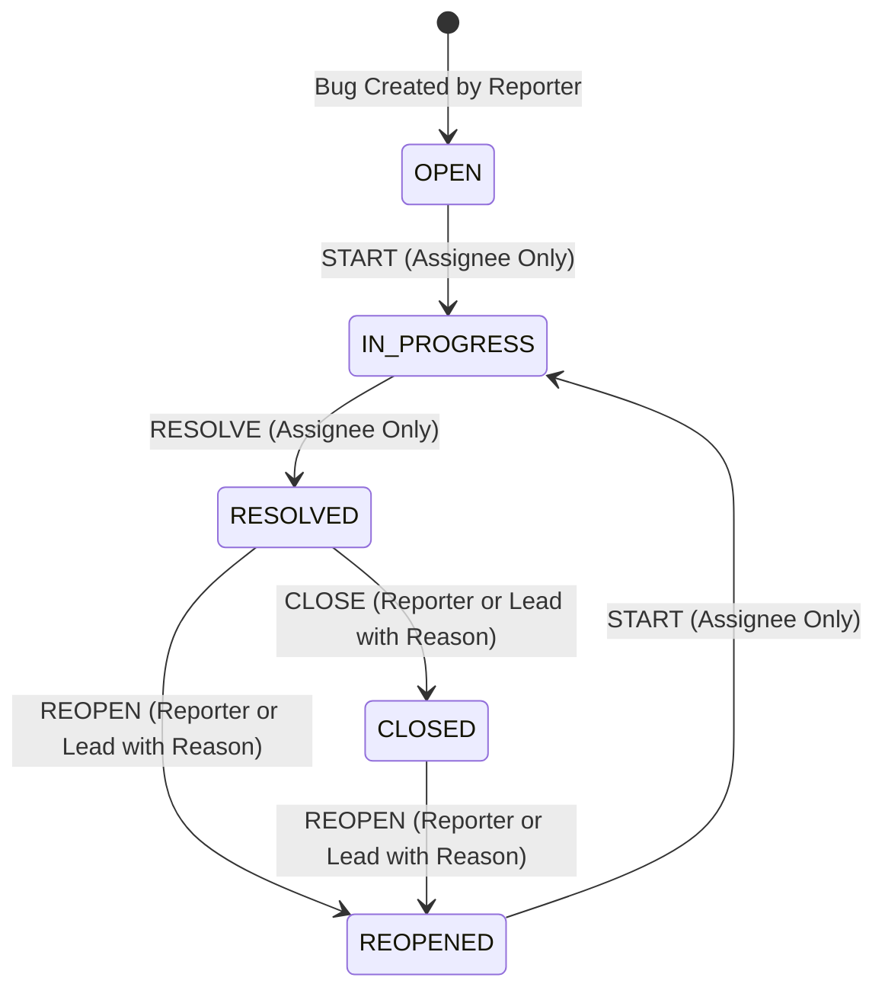

# Bug Lifecycle & State Machine Specification

## Jira Lite Secure Bug Tracker

This document describes the defect lifecycle, state machine transitions, actor permissions, optimistic locking concurrency controls, assignment rules, and reopening rules implemented in `BugService.java`.

---

## 1. Bug Statuses

The defect tracking workflow utilizes five discrete states defined in `BugStatus.java`:

| Status | Code Identifier | Description |
|---|---|---|
| **Open** | `OPEN` | Newly reported defect. Awaiting triage, assignment, or developer work. |
| **In Progress** | `IN_PROGRESS` | Defect is actively being worked on by the assigned developer. |
| **Resolved** | `RESOLVED` | Assigned developer has completed the fix or mitigation; awaiting reporter verification. |
| **Closed** | `CLOSED` | Reporter or Project Lead has verified the fix and formally accepted defect closure. |
| **Reopened** | `REOPENED` | Defect previously resolved or closed has failed verification or regressed. |

---

## 2. Mermaid State Transition Diagram

The state diagram below is derived directly from `BugService.validTransition()` and the actor permission checks in `BugService.transition()`:



---

## 3. Allowed Transitions & Authorization Rules

All state transitions are processed by `POST /api/projects/{projectId}/bugs/{bugId}/transitions`. 

If a requested transition is not in the legal transition graph, `BugService` throws HTTP 422 Unprocessable Entity (`"Invalid status transition"`). If an unauthorized actor attempts a transition, the service throws HTTP 403 Forbidden (`"Actor cannot perform this transition"`).

| Source Status | Target Status | Required Actor | Business & Validation Rules | History Event |
|---|---|---|---|---|
| `OPEN` | `IN_PROGRESS` | **Assignee Only** | Actor must be assigned to the bug (`bug.assignee_id == actor.id`). A bug cannot enter `IN_PROGRESS` without an assignee. | `STATUS_CHANGE`<br/>old: `OPEN`<br/>new: `IN_PROGRESS` |
| `IN_PROGRESS` | `RESOLVED` | **Assignee Only** | Actor must be assigned to the bug (`bug.assignee_id == actor.id`). Signifies completion of development. | `STATUS_CHANGE`<br/>old: `IN_PROGRESS`<br/>new: `RESOLVED` |
| `RESOLVED` | `CLOSED` | **Reporter** OR **Project Lead** | A non-blank `reason` is mandatory (HTTP 400 if missing or whitespace). The reason is persisted in `bugs.resolution`. | `STATUS_CHANGE`<br/>old: `RESOLVED`<br/>new: `CLOSED`<br/>reason: `<reason>` |
| `RESOLVED` | `REOPENED` | **Reporter** OR **Project Lead** | A non-blank `reason` is mandatory (HTTP 400 if missing or whitespace). The previous `bugs.resolution` is cleared to `NULL`. | `STATUS_CHANGE`<br/>old: `RESOLVED`<br/>new: `REOPENED`<br/>reason: `<reason>` |
| `CLOSED` | `REOPENED` | **Reporter** OR **Project Lead** | A non-blank `reason` is mandatory (HTTP 400 if missing or whitespace). The previous `bugs.resolution` is cleared to `NULL`. | `STATUS_CHANGE`<br/>old: `CLOSED`<br/>new: `REOPENED`<br/>reason: `<reason>` |
| `REOPENED` | `IN_PROGRESS` | **Assignee Only** | Actor must be assigned to the bug (`bug.assignee_id == actor.id`). Re-initiates active investigation. | `STATUS_CHANGE`<br/>old: `REOPENED`<br/>new: `IN_PROGRESS` |

### Disallowed Direct Transitions
The following transitions are rejected with HTTP 422 Unprocessable Entity:
- `OPEN` directly to `RESOLVED` or `CLOSED`.
- `IN_PROGRESS` directly to `CLOSED` or `REOPENED`.
- `CLOSED` directly to `RESOLVED` or `IN_PROGRESS`.
- `REOPENED` directly to `RESOLVED` or `CLOSED`.

---

## 4. Concurrency Control: Optimistic Locking via `@Version`

To protect data consistency and prevent concurrent update hazards (lost updates), the application implements optimistic locking:

1. **Schema Column:** The `bugs` table contains a `version BIGINT NOT NULL DEFAULT 0` column.
2. **JPA Mapping:** The `Bug` entity maps this field with `@Version private Long version = 0L;`.
3. **Client Requirement:** Every mutating operation must provide the expected entity version in the request payload:
   - `PATCH /api/projects/{projectId}/bugs/{bugId}` (`UpdateBugRequest.version`)
   - `PUT /api/projects/{projectId}/bugs/{bugId}/assignee` (`AssignBugRequest.version`)
   - `POST /api/projects/{projectId}/bugs/{bugId}/transitions` (`TransitionBugRequest.version`)
4. **Validation Check:** Before updating, `BugService` executes:
   ```java
   if (!bug.getVersion().equals(request.version())) {
       throw new ResponseStatusException(HttpStatus.CONFLICT, "Bug was changed by another request");
   }
   ```
5. **Conflict Handling:** If another transaction modified and committed the bug first, the version in the database increments, causing the check to fail. The server returns HTTP 409 Conflict. The client must reload the latest bug state before attempting another edit.
6. **Fresh Version Guarantee:** To eliminate the stale version hazard where the server returned the pre-flush in-memory entity version, all mutating endpoints (`updateBug`, `assignBug`, `transition`, and `addComment`) invoke `bugs.saveAndFlush(bug)`. This forces Hibernate to synchronize dirty state with the database and increment the `@Version` field immediately, returning the fresh entity version in `BugResponse` so clients can safely chain subsequent updates.

---

## 5. Bug Assignment Rules

Bug assignment is handled by `PUT /api/projects/{projectId}/bugs/{bugId}/assignee`:

1. **Role Enforcement:** Only members with `ProjectRole.PROJECT_LEAD` within the project can assign bugs. Non-leads receive HTTP 403 Forbidden (`"Project lead required"`).
2. **Project Membership Constraint:** The assignee must be an existing member of the project:
   ```java
   ProjectMember assignee = members.findByProjectIdAndUserId(projectId, request.userId())
           .orElseThrow(() -> new ResponseStatusException(
                   HttpStatus.BAD_REQUEST, "Assignee must be a project member"));
   ```
   Assigning a user who is not a member of the project is rejected with HTTP 400 Bad Request.
3. **Audit History:** Every assignment or reassignment appends an event to `bug_history`:
   - `event_type`: `"ASSIGNMENT"`
   - `old_value`: Previous assignee user ID string (or `null` if unassigned)
   - `new_value`: New assignee user ID string

---

## 6. Field Edit Rules (`updateBug`)

Field updates are handled by `PATCH /api/projects/{projectId}/bugs/{bugId}`:

1. **Closed Bug Immutability:** If a bug's status is `CLOSED`, core fields cannot be edited under any circumstance (HTTP 403 Forbidden).
2. **Actor Eligibility:**
   - **`PROJECT_LEAD`:** May edit fields on any bug in the project, provided it is not in `CLOSED` status.
   - **Reporter:** May edit fields **only** if they reported the bug (`bug.reporter.id == actor.id`) and the bug is still in `OPEN` status.
   - **Developers / Other Members:** Cannot edit core bug fields (HTTP 403 Forbidden).
3. **Editable Fields:** `title`, `description`, `priority`, and `severity`.
4. **Audit History:** Full before-and-after snapshots are written to `bug_history` with event type `FIELD_EDIT`.

---

## 7. Dynamic Action Resolution (`allowedActions`)

When retrieving a bug's details (`GET /api/projects/{projectId}/bugs/{bugId}`), `BugService.allowedActions()` calculates the exact permissible actions for the current user:

| Action Token | Condition | Meaning |
|---|---|---|
| `EDIT_FIELDS` | Status != `CLOSED` AND (`PROJECT_LEAD` OR (Reporter AND Status == `OPEN`)) | User can edit title, description, priority, severity. |
| `ASSIGN` | Role == `PROJECT_LEAD` | User can assign or reassign the bug. |
| `START` | Assignee == Actor AND Status IN (`OPEN`, `REOPENED`) | Assignee can move bug to `IN_PROGRESS`. |
| `RESOLVE` | Assignee == Actor AND Status == `IN_PROGRESS` | Assignee can move bug to `RESOLVED`. |
| `CLOSE` | (Reporter == Actor OR Role == `PROJECT_LEAD`) AND Status == `RESOLVED` | User can accept fix and close bug. |
| `REOPEN` | (Reporter == Actor OR Role == `PROJECT_LEAD`) AND Status IN (`RESOLVED`, `CLOSED`) | User can reopen bug with a mandatory reason. |
