# Database Entity Relationship Specification

## Jira Lite Secure Bug Tracker

This document describes the exact relational schema defined exclusively by the committed Flyway migration files (`V1__init.sql` through `V11__add_google_identity.sql`).

---

## 1. Mermaid Entity-Relationship Diagram

```mermaid
erDiagram
    users ||--o{ project_members : "participates in"
    projects ||--o{ project_members : "contains"
    users ||--o{ bugs : "reports"
    users ||--o{ bugs : "assigned to"
    projects ||--o{ bugs : "scopes"
    users ||--o{ bug_attachments : "uploads"
    bugs ||--o{ bug_comments : "receives"
    users ||--o{ bug_comments : "authors"
    bugs ||--o{ bug_history : "records changes for"
    users ||--o{ bug_history : "acts in"
    projects ||--o| github_repository_bindings : "bound to"
    github_webhook_deliveries ||--o{ github_event_references : "generates"
    bugs ||--o{ github_event_references : "referenced by"

    users {
        BIGINT id PK "AUTO_INCREMENT"
        VARCHAR email "254 chars, NOT NULL, UNIQUE uq_users_email"
        VARCHAR display_name "100 chars, NOT NULL"
        VARCHAR password_hash "100 chars, NOT NULL"
        VARCHAR google_sub "255 chars, NULL, UNIQUE uq_users_google_sub"
        VARCHAR role "20 chars, NOT NULL, CHECK IN ('USER', 'APP_ADMIN')"
        BOOLEAN enabled "NOT NULL, DEFAULT TRUE"
        INT failed_attempts "NOT NULL, DEFAULT 0"
        TIMESTAMP_6 locked_until "NULL"
        TIMESTAMP_6 created_at "NOT NULL, DEFAULT CURRENT_TIMESTAMP(6)"
        TIMESTAMP_6 updated_at "NOT NULL, DEFAULT CURRENT_TIMESTAMP(6) ON UPDATE CURRENT_TIMESTAMP(6)"
    }

    projects {
        BIGINT id PK "AUTO_INCREMENT"
        VARCHAR project_key "20 chars, NOT NULL, UNIQUE uq_projects_key"
        VARCHAR name "100 chars, NOT NULL"
        VARCHAR description "500 chars, NULL"
        TIMESTAMP_6 created_at "NOT NULL, DEFAULT CURRENT_TIMESTAMP(6)"
    }

    project_members {
        BIGINT project_id PK,FK "NOT NULL, REFERENCES projects(id)"
        BIGINT user_id PK,FK "NOT NULL, REFERENCES users(id)"
        VARCHAR role "20 chars, NOT NULL, CHECK IN ('REPORTER','DEVELOPER','PROJECT_LEAD')"
    }

    bugs {
        BIGINT id PK "AUTO_INCREMENT"
        VARCHAR bug_key "50 chars, NOT NULL, UNIQUE uq_bugs_key"
        BIGINT project_id FK "NOT NULL, REFERENCES projects(id), INDEX idx_bugs_project"
        BIGINT reporter_id FK "NOT NULL, REFERENCES users(id), INDEX idx_bugs_reporter"
        BIGINT assignee_id FK "NULL, REFERENCES users(id), INDEX idx_bugs_assignee"
        VARCHAR title "120 chars, NOT NULL"
        VARCHAR description "5000 chars, NOT NULL"
        VARCHAR priority "20 chars, NOT NULL, CHECK IN ('LOW','MEDIUM','HIGH','CRITICAL')"
        VARCHAR severity "20 chars, NOT NULL, CHECK IN ('TRIVIAL','MINOR','MAJOR','CRITICAL')"
        VARCHAR status "20 chars, NOT NULL, DEFAULT 'OPEN', CHECK IN ('OPEN','IN_PROGRESS','RESOLVED','CLOSED','REOPENED'), INDEX idx_bugs_status"
        VARCHAR resolution "500 chars, NULL"
        BIGINT version "NOT NULL, DEFAULT 0"
        TIMESTAMP_6 created_at "NOT NULL, DEFAULT CURRENT_TIMESTAMP(6), INDEX idx_bugs_created_at"
        TIMESTAMP_6 updated_at "NOT NULL, DEFAULT CURRENT_TIMESTAMP(6) ON UPDATE CURRENT_TIMESTAMP(6)"
    }

    bug_attachments {
        BIGINT id PK "AUTO_INCREMENT"
        VARCHAR bug_key "50 chars, NOT NULL"
        VARCHAR original_name "255 chars, NOT NULL"
        VARCHAR content_type "100 chars, NOT NULL"
        VARCHAR storage_name "100 chars, NOT NULL, UNIQUE uq_bug_attachments_storage"
        BIGINT size_bytes "NOT NULL"
        BIGINT uploaded_by FK "NOT NULL, REFERENCES users(id)"
        TIMESTAMP_6 created_at "NOT NULL, DEFAULT CURRENT_TIMESTAMP(6)"
    }

    bug_comments {
        BIGINT id PK "AUTO_INCREMENT"
        BIGINT bug_id FK "NOT NULL, REFERENCES bugs(id), INDEX idx_bug_comments_bug_created"
        BIGINT author_id FK "NOT NULL, REFERENCES users(id)"
        VARCHAR body "5000 chars, NOT NULL"
        TIMESTAMP_6 created_at "NOT NULL, DEFAULT CURRENT_TIMESTAMP(6), INDEX idx_bug_comments_bug_created"
    }

    bug_history {
        BIGINT id PK "AUTO_INCREMENT"
        BIGINT bug_id FK "NOT NULL, REFERENCES bugs(id), INDEX idx_bug_history_bug_created"
        BIGINT actor_id FK "NULL, REFERENCES users(id)"
        VARCHAR event_type "30 chars, NOT NULL"
        VARCHAR old_value "5000 chars, NULL"
        VARCHAR new_value "5000 chars, NULL"
        VARCHAR reason "5000 chars, NULL"
        VARCHAR external_author "254 chars, NULL"
        TIMESTAMP_6 created_at "NOT NULL, DEFAULT CURRENT_TIMESTAMP(6), INDEX idx_bug_history_bug_created"
    }

    github_repository_bindings {
        BIGINT id PK "AUTO_INCREMENT"
        BIGINT project_id FK "NOT NULL, UNIQUE uq_github_binding_project, REFERENCES projects(id)"
        BIGINT installation_id "NOT NULL"
        BIGINT repository_id "NOT NULL, UNIQUE uq_github_binding_repository"
        VARCHAR owner "100 chars, NOT NULL"
        VARCHAR repository_name "100 chars, NOT NULL"
        VARCHAR full_name "201 chars, NOT NULL"
        TIMESTAMP_6 created_at "NOT NULL, DEFAULT CURRENT_TIMESTAMP(6)"
    }

    github_webhook_deliveries {
        BIGINT id PK "AUTO_INCREMENT"
        VARCHAR delivery_id "100 chars, NOT NULL, UNIQUE uq_github_delivery"
        VARCHAR event_type "50 chars, NOT NULL"
        MEDIUMBLOB payload "NOT NULL"
        VARCHAR status "20 chars, NOT NULL"
        INT attempts "NOT NULL, DEFAULT 0"
        VARCHAR last_error "1000 chars, NULL"
        TIMESTAMP_6 received_at "NOT NULL, DEFAULT CURRENT_TIMESTAMP(6)"
        TIMESTAMP_6 processed_at "NULL"
    }

    github_event_references {
        BIGINT id PK "AUTO_INCREMENT"
        BIGINT delivery_id FK "NOT NULL, REFERENCES github_webhook_deliveries(id)"
        VARCHAR reference_key "100 chars, NOT NULL"
        VARCHAR external_type "20 chars, NOT NULL"
        VARCHAR external_id "200 chars, NOT NULL"
        BIGINT repository_id "NOT NULL"
        BIGINT bug_id FK "NOT NULL, REFERENCES bugs(id)"
        TIMESTAMP_6 created_at "NOT NULL, DEFAULT CURRENT_TIMESTAMP(6)"
    }
```

---

## 2. Table Specifications & Constraints

### 2.1 `users`
Created in `V1__init.sql`; constraints adjusted in `V2__align_user_role_constraint.sql` and `V8__separate_global_and_project_roles.sql`; Google identity column and unique constraint added in `V11__add_google_identity.sql`.

| Column | Data Type | Nullable | Default | Constraints & Description |
|---|---|---|---|---|
| `id` | BIGINT | No | *AUTO_INCREMENT* | Primary Key. |
| `email` | VARCHAR(254) | No | *None* | Unique (`uq_users_email`). Lowercase user login email. |
| `display_name` | VARCHAR(100) | No | *None* | User full name. |
| `password_hash` | VARCHAR(100) | No | *None* | Encoded password hash with prefix (`{bcrypt}...`). |
| `google_sub` | VARCHAR(255) | Yes | `NULL` | Unique (`uq_users_google_sub`). Google OAuth subject identifier. |
| `role` | VARCHAR(20) | No | *None* | Check constraint `ck_users_role`: `CHECK (role IN ('USER', 'APP_ADMIN'))`. |
| `enabled` | BOOLEAN | No | `TRUE` | Account active flag. |
| `failed_attempts` | INT | No | `0` | Consecutive login failures counter. |
| `locked_until` | TIMESTAMP(6) | Yes | `NULL` | Account lockout expiration timestamp. |
| `created_at` | TIMESTAMP(6) | No | `CURRENT_TIMESTAMP(6)` | Account creation timestamp. |
| `updated_at` | TIMESTAMP(6) | No | `CURRENT_TIMESTAMP(6)` | Automatic update timestamp on record modification. |

### 2.2 `projects`
Created in `V3__create_projects_and_attachments.sql`; description aligned in `V5__align_projects_description.sql`; key made mandatory and unique in `V6__align_project_key.sql`.

| Column | Data Type | Nullable | Default | Constraints & Description |
|---|---|---|---|---|
| `id` | BIGINT | No | *AUTO_INCREMENT* | Primary Key. |
| `project_key` | VARCHAR(20) | No | *None* | Unique (`uq_projects_key`). Uppercase prefix for bugs (e.g., `JILA`). |
| `name` | VARCHAR(100) | No | *None* | Descriptive project title. |
| `description` | VARCHAR(500) | Yes | `NULL` | Optional project description. |
| `created_at` | TIMESTAMP(6) | No | `CURRENT_TIMESTAMP(6)` | Project creation timestamp. |

### 2.3 `project_members`
Created in `V3__create_projects_and_attachments.sql`; role aligned in `V4__align_project_members_role.sql`.

| Column | Data Type | Nullable | Default | Constraints & Description |
|---|---|---|---|---|
| `project_id` | BIGINT | No | *None* | Composite Primary Key; Foreign Key `fk_project_members_project` -> `projects(id)`. |
| `user_id` | BIGINT | No | *None* | Composite Primary Key; Foreign Key `fk_project_members_user` -> `users(id)`. |
| `role` | VARCHAR(20) | No | `'REPORTER'` | Check constraint `ck_project_members_role`: `CHECK (role IN ('REPORTER','DEVELOPER','PROJECT_LEAD'))`. |

*Structural Note on Project Leadership:* The project lead is stored as a membership role (`role = 'PROJECT_LEAD'`) inside the `project_members` association table. There is no `lead_user_id` column on the `projects` table in the database schema.

### 2.4 `bugs`
Created in `V7__create_bugs.sql`.

| Column | Data Type | Nullable | Default | Constraints & Description |
|---|---|---|---|---|
| `id` | BIGINT | No | *AUTO_INCREMENT* | Primary Key. |
| `bug_key` | VARCHAR(50) | No | *None* | Unique (`uq_bugs_key`). Human-readable identifier (`<PROJECT_KEY>-<ID>`). |
| `project_id` | BIGINT | No | *None* | Foreign Key `fk_bugs_project` -> `projects(id)`. Index `idx_bugs_project`. |
| `reporter_id` | BIGINT | No | *None* | Foreign Key `fk_bugs_reporter` -> `users(id)`. Index `idx_bugs_reporter`. |
| `assignee_id` | BIGINT | Yes | `NULL` | Foreign Key `fk_bugs_assignee` -> `users(id)`. Index `idx_bugs_assignee`. |
| `title` | VARCHAR(120) | No | *None* | Bug title (min 5, max 120 chars). |
| `description` | VARCHAR(5000) | No | *None* | Bug description details. |
| `priority` | VARCHAR(20) | No | *None* | Check constraint `ck_bugs_priority`: `CHECK (priority IN ('LOW', 'MEDIUM', 'HIGH', 'CRITICAL'))`. |
| `severity` | VARCHAR(20) | No | *None* | Check constraint `ck_bugs_severity`: `CHECK (severity IN ('TRIVIAL', 'MINOR', 'MAJOR', 'CRITICAL'))`. |
| `status` | VARCHAR(20) | No | `'OPEN'` | Check constraint `ck_bugs_status`: `CHECK (status IN ('OPEN', 'IN_PROGRESS', 'RESOLVED', 'CLOSED', 'REOPENED'))`. Index `idx_bugs_status`. |
| `resolution` | VARCHAR(500) | Yes | `NULL` | Explanation recorded upon closing. Cleared upon reopening. |
| `version` | BIGINT | No | `0` | JPA optimistic locking version number. Incremented on every update. |
| `created_at` | TIMESTAMP(6) | No | `CURRENT_TIMESTAMP(6)` | Creation timestamp. Index `idx_bugs_created_at`. |
| `updated_at` | TIMESTAMP(6) | No | `CURRENT_TIMESTAMP(6)` | Automatic update timestamp on modification. |

### 2.5 `bug_attachments`
Created in `V3__create_projects_and_attachments.sql`.

| Column | Data Type | Nullable | Default | Constraints & Description |
|---|---|---|---|---|
| `id` | BIGINT | No | *AUTO_INCREMENT* | Primary Key. |
| `bug_key` | VARCHAR(50) | No | *None* | Associated bug key string. (Logical relation to `bugs.bug_key`). |
| `original_name` | VARCHAR(255) | No | *None* | Sanitized original filename. |
| `content_type` | VARCHAR(100) | No | *None* | MIME type of uploaded file. |
| `storage_name` | VARCHAR(100) | No | *None* | Unique (`uq_bug_attachments_storage`). Random UUID filename on disk. |
| `size_bytes` | BIGINT | No | *None* | File size in bytes (max 10 MB). |
| `uploaded_by` | BIGINT | No | *None* | Foreign Key `fk_bug_attachments_user` -> `users(id)`. |
| `created_at` | TIMESTAMP(6) | No | `CURRENT_TIMESTAMP(6)` | Upload timestamp. |

### 2.6 `bug_comments`
Created in `V9__create_bug_comments_and_history.sql`.

| Column | Data Type | Nullable | Default | Constraints & Description |
|---|---|---|---|---|
| `id` | BIGINT | No | *AUTO_INCREMENT* | Primary Key. |
| `bug_id` | BIGINT | No | *None* | Foreign Key `fk_bug_comments_bug` -> `bugs(id)`. Composite index `idx_bug_comments_bug_created (bug_id, created_at)`. |
| `author_id` | BIGINT | No | *None* | Foreign Key `fk_bug_comments_author` -> `users(id)`. |
| `body` | VARCHAR(5000) | No | *None* | Comment text. |
| `created_at` | TIMESTAMP(6) | No | `CURRENT_TIMESTAMP(6)` | Comment creation timestamp. Part of composite index. |

### 2.7 `bug_history`
Created in `V9__create_bug_comments_and_history.sql`; altered in `V10__github_tracking.sql` (`actor_id` made nullable; `external_author` column added).

| Column | Data Type | Nullable | Default | Constraints & Description |
|---|---|---|---|---|
| `id` | BIGINT | No | *AUTO_INCREMENT* | Primary Key. |
| `bug_id` | BIGINT | No | *None* | Foreign Key `fk_bug_history_bug` -> `bugs(id)`. Composite index `idx_bug_history_bug_created (bug_id, created_at)`. |
| `actor_id` | BIGINT | Yes | `NULL` | Foreign Key `fk_bug_history_actor` -> `users(id)`. `NULL` for external GitHub events. |
| `event_type` | VARCHAR(30) | No | *None* | Event type: `CREATED`, `FIELD_EDIT`, `ASSIGNMENT`, `STATUS_CHANGE`, `COMMENT`, `COMMIT`, `PULL_REQUEST`. |
| `old_value` | VARCHAR(5000) | Yes | `NULL` | Prior field value before modification. |
| `new_value` | VARCHAR(5000) | Yes | `NULL` | New field value after modification. |
| `reason` | VARCHAR(5000) | Yes | `NULL` | Transition reason, closing explanation, or comment text. |
| `external_author`| VARCHAR(254) | Yes | `NULL` | GitHub author username/email for external webhook events. |
| `created_at` | TIMESTAMP(6) | No | `CURRENT_TIMESTAMP(6)` | Event timestamp. Part of composite index. |

### 2.8 `github_repository_bindings`
Created in `V10__github_tracking.sql`.

| Column | Data Type | Nullable | Default | Constraints & Description |
|---|---|---|---|---|
| `id` | BIGINT | No | *AUTO_INCREMENT* | Primary Key. |
| `project_id` | BIGINT | No | *None* | Unique (`uq_github_binding_project`). Foreign Key `fk_github_binding_project` -> `projects(id)`. |
| `installation_id`| BIGINT | No | *None* | GitHub App installation ID. |
| `repository_id` | BIGINT | No | *None* | Unique (`uq_github_binding_repository`). GitHub repository ID. |
| `owner` | VARCHAR(100) | No | *None* | GitHub owner account name. |
| `repository_name`| VARCHAR(100) | No | *None* | Repository name. |
| `full_name` | VARCHAR(201) | No | *None* | Combined repository slug (`owner/repository_name`). |
| `created_at` | TIMESTAMP(6) | No | `CURRENT_TIMESTAMP(6)` | Binding creation timestamp. |

### 2.9 `github_webhook_deliveries`
Created in `V10__github_tracking.sql`.

| Column | Data Type | Nullable | Default | Constraints & Description |
|---|---|---|---|---|
| `id` | BIGINT | No | *AUTO_INCREMENT* | Primary Key. |
| `delivery_id` | VARCHAR(100) | No | *None* | Unique (`uq_github_delivery`). GitHub delivery UUID header. |
| `event_type` | VARCHAR(50) | No | *None* | GitHub event name (`push`, `pull_request`). |
| `payload` | MEDIUMBLOB | No | *None* | Exact raw payload bytes received. |
| `status` | VARCHAR(20) | No | *None* | Processing status: `RECEIVED`, `PROCESSING`, `PROCESSED`, `FAILED`. |
| `attempts` | INT | No | `0` | Number of processing attempts. |
| `last_error` | VARCHAR(1000)| Yes | `NULL` | Error message if processing failed. |
| `received_at` | TIMESTAMP(6) | No | `CURRENT_TIMESTAMP(6)` | Receipt timestamp. |
| `processed_at` | TIMESTAMP(6) | Yes | `NULL` | Completion timestamp. |

### 2.10 `github_event_references`
Created in `V10__github_tracking.sql`.

| Column | Data Type | Nullable | Default | Constraints & Description |
|---|---|---|---|---|
| `id` | BIGINT | No | *AUTO_INCREMENT* | Primary Key. |
| `delivery_id` | BIGINT | No | *None* | Foreign Key `fk_github_event_delivery` -> `github_webhook_deliveries(id)`. |
| `reference_key` | VARCHAR(100) | No | *None* | Bug key extracted from message/title (e.g., `JILA-42`). |
| `external_type` | VARCHAR(20) | No | *None* | Source entity type (`COMMIT`, `PULL_REQUEST`). |
| `external_id` | VARCHAR(200) | No | *None* | External commit SHA or PR ID. |
| `repository_id` | BIGINT | No | *None* | GitHub repository ID. |
| `bug_id` | BIGINT | No | *None* | Foreign Key `fk_github_event_bug` -> `bugs(id)`. |
| `created_at` | TIMESTAMP(6) | No | `CURRENT_TIMESTAMP(6)` | Recording timestamp. |

*Unique Constraint:* `uq_github_event_reference` on `(repository_id, external_type, external_id, bug_id)` prevents recording duplicate commit or pull request references against the same bug.

---

## 3. Verbal Relationship Mapping

| Parent Entity | Child Entity | Cardinality | Join Mechanism | Description |
|---|---|---|---|---|
| `users` | `project_members` | One-to-Many | `users.id = project_members.user_id` | A user can be a member of zero or more projects. |
| `projects` | `project_members` | One-to-Many | `projects.id = project_members.project_id` | A project contains one or more members. Composite PK `(project_id, user_id)`. |
| `projects` | `bugs` | One-to-Many | `projects.id = bugs.project_id` | A project contains zero or more bugs. |
| `users` | `bugs` (reporter) | One-to-Many | `users.id = bugs.reporter_id` | A user can report zero or more bugs. Mandatory FK. |
| `users` | `bugs` (assignee) | One-to-Many | `users.id = bugs.assignee_id` | A user can be assigned zero or more bugs. Optional FK (`NULL` allowed). |
| `users` | `bug_attachments` | One-to-Many | `users.id = bug_attachments.uploaded_by` | A user uploads zero or more attachments. |
| `bugs` | `bug_comments` | One-to-Many | `bugs.id = bug_comments.bug_id` | A bug contains zero or more discussion comments. |
| `users` | `bug_comments` | One-to-Many | `users.id = bug_comments.author_id` | A user writes zero or more bug comments. |
| `bugs` | `bug_history` | One-to-Many | `bugs.id = bug_history.bug_id` | A bug has an append-only timeline of state and field modifications. |
| `users` | `bug_history` | One-to-Many | `users.id = bug_history.actor_id` | A user triggers audit events. `NULL` for automated GitHub events. |
| `projects` | `github_repository_bindings` | One-to-One | `projects.id = github_repository_bindings.project_id` | A project can be bound to at most one GitHub repository (enforced by `uq_github_binding_project`). |
| `github_webhook_deliveries` | `github_event_references` | One-to-Many | `github_webhook_deliveries.id = github_event_references.delivery_id` | A webhook delivery can trigger zero or more bug references. |
| `bugs` | `github_event_references` | One-to-Many | `bugs.id = github_event_references.bug_id` | A bug can be referenced across multiple commits or pull requests. |
